<div align="center">

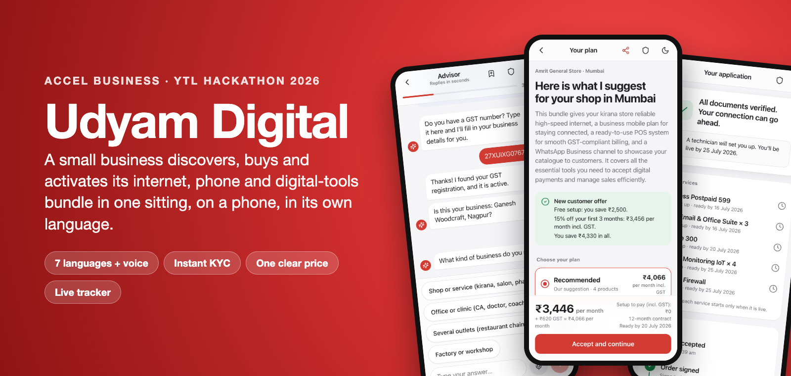

# Udyam Digital

**A small business discovers, buys and activates its internet, phone and digital-tools bundle in one sitting:<br>on a phone, in its own language.**

     

YTL Hackathon 2026 · Enterprise Track A · **Team NeuralNinjas (IIITD)**

[See it working](#see-it-working) · [Run it](#run-it-in-2-minutes) · [How it works](#how-it-works) · [Privacy](#privacy-by-design) · [Tests](#tested)

</div>

---

## The problem

Accel Business, the case's telecom operator, sells to small businesses through a field sales force built for large companies. In the quarter's data:

<table>
<tr>
<td align="center" width="25%"><h2>7.4%</h2>of 5,000 leads became customers</td>
<td align="center" width="25%"><h2>17.6 days</h2>from first contact to going live</td>
<td align="center" width="25%"><h2>₹15,053</h2>spent to win each customer</td>
<td align="center" width="25%"><h2>3 calls</h2>per customer chasing their order</td>
</tr>
</table>

**Udyam Digital replaces the sales visit, the 3–5 day PDF quote and the paperwork with one chat on the owner's phone.** It recommends the right bundle, shows one honest monthly price, verifies the business instantly and tracks installation. People still step in where they add value.

---

## See it working

<table>
<tr>
<td width="40%" align="center">
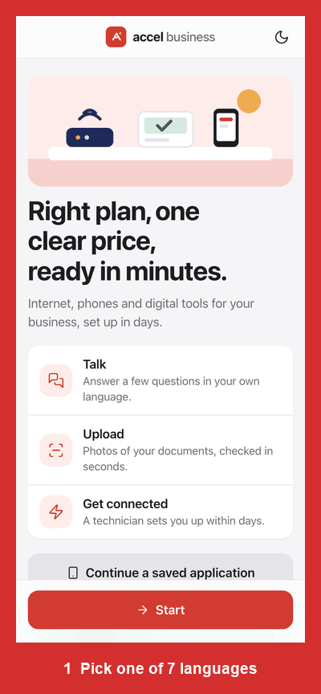
</td>
<td width="60%">

### One owner, start to finish

1. **Pick a language.** English, हिंदी, मराठी, ગુજરાતી, தமிழ், తెలుగు or ಕನ್ನಡ.
2. **Chat for two minutes.** One GST number fills in the business name and city from the registry. Owners can type, tap or speak (English and Hindi).
3. **Get a plan with one clear price.** GST is shown, every product has a reason, and extras are ranked by what similar businesses bought.
4. **Bargain if you like.** The first ask shows cheaper ways to pay; insisting gets 5%, then 10%, then a salesperson. Never below the catalogue minimum.
5. **Verify instantly.** Verify a mobile number, give consent, then fetch certificates from DigiLocker or snap photos. They're checked against the GST and Udyam registries in seconds.
6. **Track the order.** Every product shows its own ready-by date, so nobody calls support.

</td>
</tr>
</table>

### The owner's screens

<table>
<tr>
<td align="center">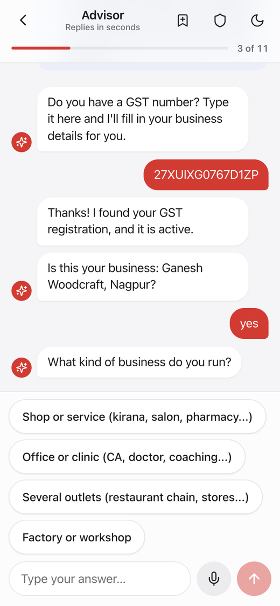<br><sub><b>AI advisor</b><br>GST lookup fills in the business</sub></td>
<td align="center">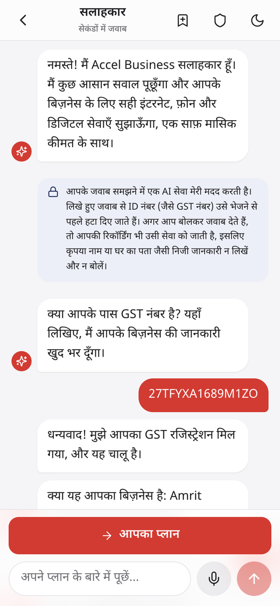<br><sub><b>7 languages</b><br>here, a kirana owner in Hindi</sub></td>
<td align="center">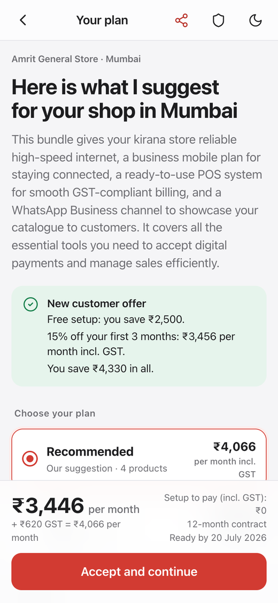<br><sub><b>One clear price</b><br>tiers, offer, GST shown</sub></td>
<td align="center">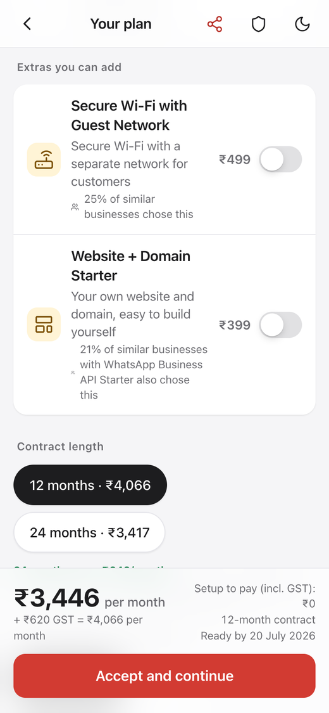<br><sub><b>Smart extras</b><br>"25% of similar businesses chose this"</sub></td>
</tr>
<tr>
<td align="center">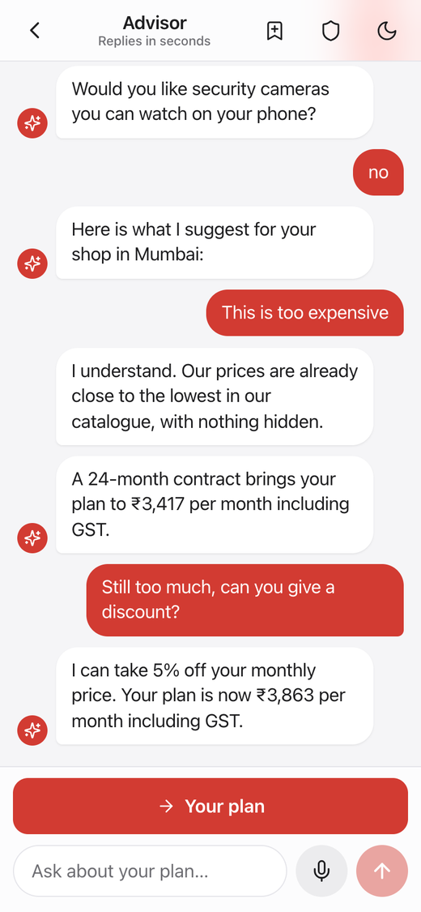<br><sub><b>Fair bargaining</b><br>limits set by us, never the AI</sub></td>
<td align="center">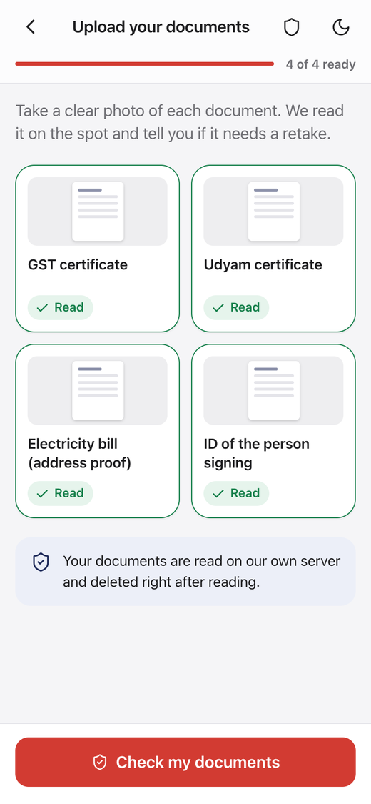<br><sub><b>Smart KYC</b><br>DigiLocker or photos, read on our server</sub></td>
<td align="center">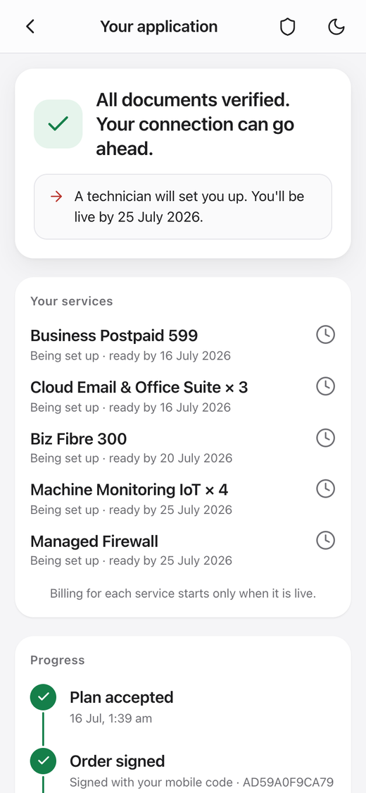<br><sub><b>Tracker</b><br>a ready-by date per product</sub></td>
<td align="center">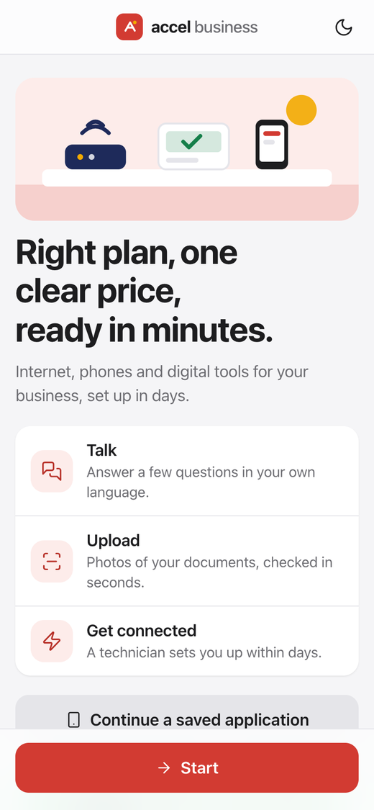<br><sub><b>Start screen</b><br>or continue on another phone</sub></td>
</tr>
</table>

### The back office, for staff and partners

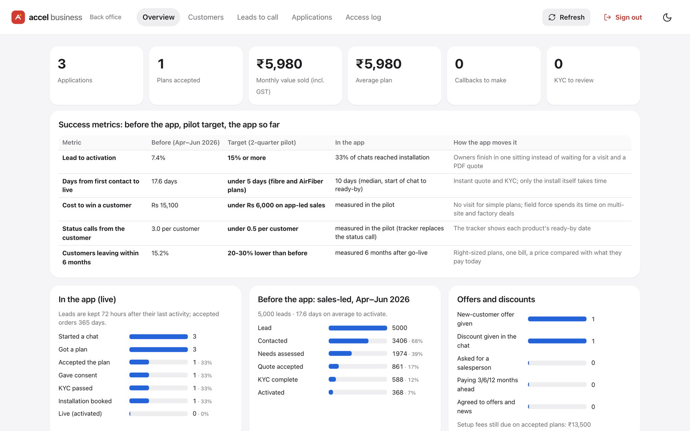

<table>
<tr>
<td align="center" width="50%">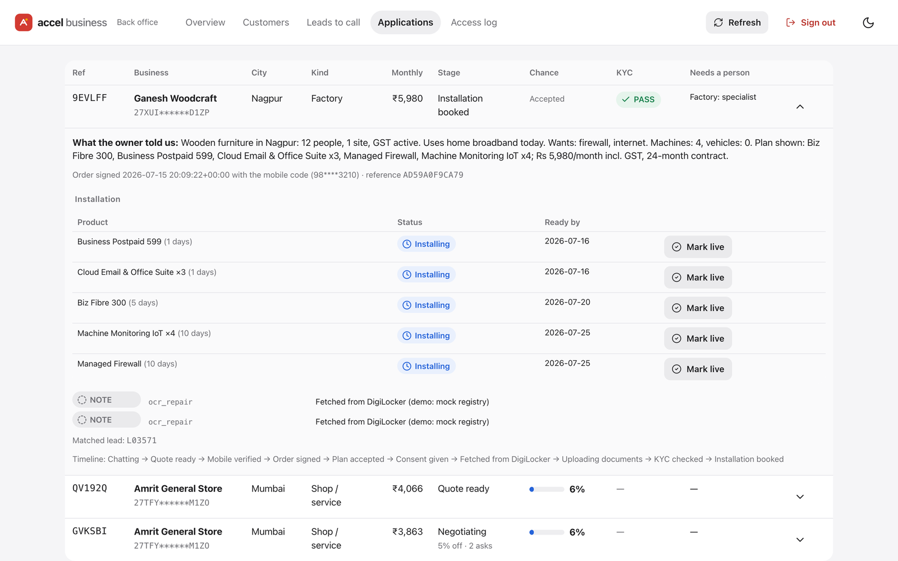<br><sub><b>Applications:</b> who needs a person and why, a summary of the owner's answers, and per-product installs with "Mark live"</sub></td>
<td align="center" width="50%">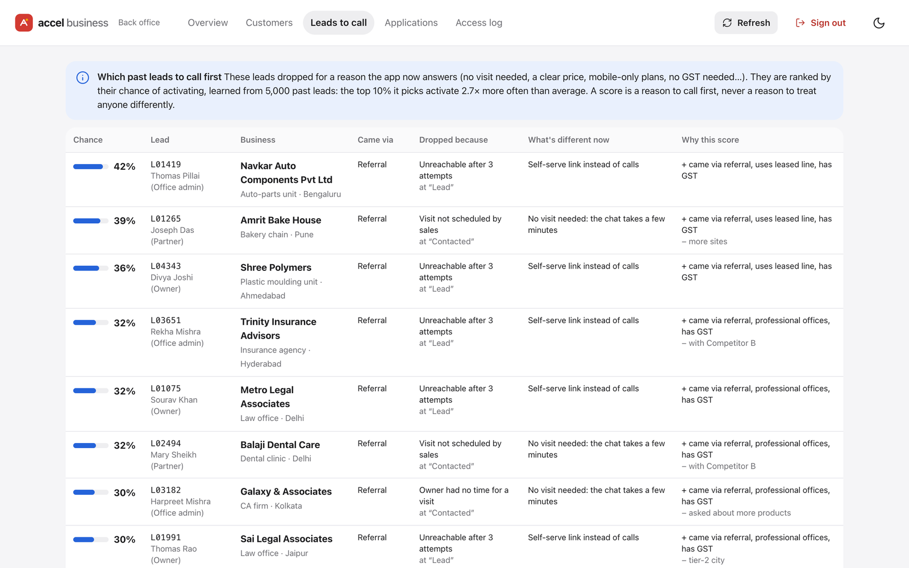<br><sub><b>Leads to call:</b> old leads ranked by a model whose top 10% activate 2.7× more often</sub></td>
</tr>
</table>

---

## What we built

| The case asked for | What Udyam Digital does |
|---|---|
| **AI advisor** that recommends a bundle in plain language | A chat in 7 languages with voice. The AI understands free text; a **rules engine** picks products from the 25-product catalogue and checks every rule (city tier, team size, GST, dependencies). Extras are ranked with **Apriori** rules and **look-alike customers**. |
| **Quote and checkout** with one transparent price | Itemised price with GST, three tiers, cheaper longer contracts, setup spread over months, pay-ahead savings, a welcome offer for new customers, and bargaining with a hard floor. |
| **Smart KYC** with extraction, validation, lookups and consent | Consent first. Local OCR straightens and reads photos, then **30+ checks** run against the GST and Udyam registries. It matches all **12/12** sample applicants in our answer key. DigiLocker demo; owners without GST need only an address proof and ID. |
| **Tracker** instead of calling support | A timeline from order to "all services live", with a ready-by date for each product from its install time. |
| *Stretch:* voice, back office, which leads to call | All three: voice in English and Hindi; a back office with hand-offs and success metrics; a conversion predictor (AUC 0.754). |

**People stay in the loop.** Leased lines, factories, 5+ sites, price asks beyond 10%, a chat that keeps failing, and help registering for GST all go to the business team, with the owner's answers attached. **Channel partners** get referral links (`/?ref=RAJ01`) that keep their commission, an assisted mode for sitting with the owner, and a login that shows only their own referrals.

---

## How it works

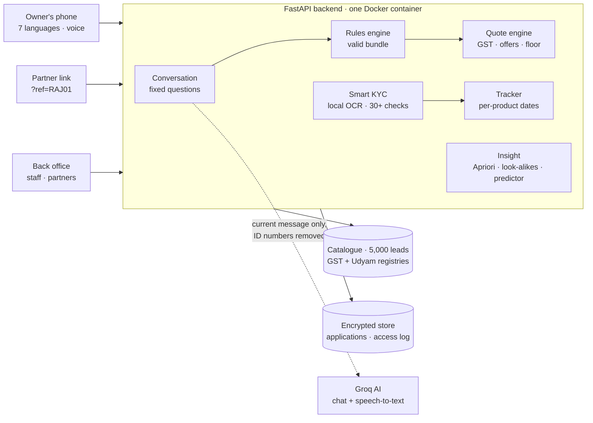

> **The AI talks, the rules decide.** The AI only reads what the owner types and explains the plan. Questions, products, quantities and every rupee come from deterministic code, so a plan can never break a catalogue rule, and the same answers always give the same plan. If the AI is down, the chat carries on in guided mode.

**Stack:** FastAPI · React + Vite · RapidOCR (ONNX) + OpenCV · NumPy · Groq (`gpt-oss-120b`, Whisper) · Fernet encryption · Docker

---

## Run it in 2 minutes

You only need **Docker**.

```bash
git clone https://github.com/Prateek20052005/NeuralNinjas_IIITD.git
cd NeuralNinjas_IIITD
cp .env.example .env            # Windows: copy .env.example .env  (then fill in the keys below)
docker build -t udyam-digital .
docker run --env-file .env -p 7860:7860 -v udyam-state:/app/state udyam-digital
```

Open **http://localhost:7860**. The back office is at **http://localhost:7860/#/office**.

<details>
<summary><b>Settings in <code>.env</code></b></summary>

| Setting | Needed? | What it does |
|---|---|---|
| `GROQ_API_KEY` | Optional | Turns on the AI and voice (free key from console.groq.com). Without it, the advisor runs in guided mode with the same rules and prices. |
| `APP_STATE_KEY` | Recommended | Encrypts saved applications so progress survives restarts. Make one: `python3 -c "import base64,os;print(base64.urlsafe_b64encode(os.urandom(32)).decode())"` |
| `BACKOFFICE_KEY` | For the back office | Any secret word; opens `/#/office` |
| `PARTNER_KEYS` | Optional | Partner logins, e.g. `RAJ01=some-key` |
| `OTP_MODE` | Keep `demo` | Shows the mobile code on screen. `sms` sends real texts via MSG91 or Twilio. |

</details>

<details>
<summary><b>Open it on a phone</b></summary>

- **Same Wi-Fi:** `http://<your-computer-ip>:7860`. Everything works except voice, which needs `https`.
- **Anywhere, with voice:** start a free Cloudflare tunnel and open the `https://….trycloudflare.com` link it prints:
  ```bash
  docker run -d --name udyam-tunnel cloudflare/cloudflared:latest tunnel --no-autoupdate --url http://host.docker.internal:7860
  docker logs udyam-tunnel
  ```
  Anyone with that link can use the app while the tunnel runs.
- **Free public hosting:** see [docs/DEPLOY.md](docs/DEPLOY.md) (Hugging Face Spaces).

</details>

<details>
<summary><b>Try it yourself: sample data</b></summary>

All businesses and documents are fictional, from the hackathon dataset.

| Try | Type or upload | You'll see |
|---|---|---|
| A furniture maker | GST `27XUIXG0767D1ZP` | Ganesh Woodcraft, Nagpur; a factory plan with a specialist offered |
| A kirana in Hindi | GST `27TFYXA1689M1ZO` | Amrit General Store, Mumbai; welcome offer, free setup |
| Documents that pass | `data/kyc_documents/K03_*.png` | PASS, installation booked |
| Documents with problems | `K01` (cancelled GST), `K04` (blurred), `K11` (bill too old) | REJECT / RETAKE with the reason |
| Bargaining | type "this is too expensive", then insist | cheaper options, then 5%, then 10%, then a salesperson |
| A partner | open `/?ref=RAJ01&assisted=1` | "Raj Telecom is helping you"; the partner sees only their referrals |

</details>

---

## Privacy by design

Built for India's **DPDP Act, 2023**:

| Principle | How the app does it |
|---|---|
| **Consent first** | KYC starts only after the owner ticks named purposes; version and time are recorded. Offers are a separate, unticked opt-in. |
| **Minimum data to the AI** | Only the current message, with GST, Udyam, PAN, phone, Aadhaar, email and the business name removed. No chat history is stored or sent. |
| **Documents stay with us** | Photos are read by OCR on our own server, in memory, then discarded. Voice recordings are never stored. |
| **Masked and encrypted** | ID numbers are masked on every screen and log (`27XUI******D1ZP`). Data is encrypted and signed at rest. |
| **Kept only as long as needed** | Unfinished applications: 72 hours. Orders: 365 days. Document details: deleted once services are live. Owners can delete everything anytime. |
| **Least privilege, audited** | Partners never see documents or ID numbers; every back-office view, including refused logins, is logged. |

---

## Tested

| What | Result |
|---|---|
| Unit and API tests: rules, quotes, KYC, consent, privacy, bargaining, voice, partners, tracker | **448 passing** |
| Owner personas in 7 languages, typed in their own words | **26 / 26** finish with a valid plan |
| KYC applicants K01–K12 against our answer key | **12 / 12** |

```bash
docker run --rm -v "$PWD":/src -w /src --user root udyam-digital \
  sh -c "pip install -q pytest httpx; python -m pytest -q -p no:cacheprovider"
```

More in [docs/TESTING.md](docs/TESTING.md).

<details>
<summary><b>Project layout</b></summary>

```
backend/app/        FastAPI app and all business logic
  advisor/          chat flow, free-text parsing in 7 languages, AI calls
  kyc/              OCR, document parsing, registry lookups, checks, DigiLocker demo
  i18n/             every screen and chat text in 7 languages
  recommend.py      rules engine          quote.py      prices, GST, offers, floor
  bundles.py        Apriori extras        similar.py    look-alike customers
  predictor.py      which leads to call   handoff.py    when a person steps in
  tracker.py        per-product dates     store.py      encryption, retention, access log
frontend/           React + Vite phone app and back office
data/               the hackathon dataset: catalogue, 5,000 leads, mock registries, 47 KYC images
tests/              pytest suite and the KYC answer key
scripts/            persona evaluation, KYC stress tests, end-to-end smoke test
docs/               hosting, testing, README images
```

</details>

<details>
<summary><b>Limits of the prototype</b></summary>

- KYC lookups, DigiLocker and e-sign run against the hackathon's mock registries; production would use DigiLocker, a licensed KYC vendor and Aadhaar e-sign.
- Real SMS works through MSG91 or Twilio, but Indian SMS needs a DLT-registered template; the demo shows codes on screen.
- No payment is taken in the app.
- Voice is on for English and Hindi; the other five languages are translated but not yet tested with speech.

</details>

---

<div align="center">
<sub>All businesses, people and documents are fictional, from the YTL Hackathon 2026 dataset. "Accel Business" is the case's fictional operator.</sub>
</div>
